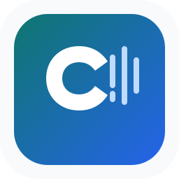

# ColVoice — Voz Colombiana

Aplicación local en español para generar voz, clonar referencias, convertir grabaciones y diseñar perfiles de voz. Todo el procesamiento se ejecuta en el equipo mediante una interfaz Gradio.

## Inicio rápido

1. Descarga o prepara el modelo en `models/` con `download_models.py`.
2. Instala las dependencias locales indicadas en `requirements-local.txt`.
3. Ejecuta `Iniciar-ColVoice.cmd`.
4. Abre `http://127.0.0.1:8001`.

ColVoice es una aplicación local optimizada para generar, clonar y transformar voces con español colombiano, mexicano y latinoamericano. El paquete Python interno conserva `omnivoice` para mantener compatibilidad con el motor base.

Voice Changer es opcional: descarga Seed-VC desde su proyecto upstream y colócalo en `vendor/seed-vc/` siguiendo [VOICE-CHANGER.md](VOICE-CHANGER.md). El repositorio no redistribuye código de terceros sin verificar ni archivos multimedia de ejemplo.

Consulta [INSTALACION.md](INSTALACION.md) para la instalación completa con NVIDIA/CUDA o CPU, descarga de modelos, uso de la API, clonación con texto pronunciado opcional y control de generación.

## Funciones

- Texto a voz con español colombiano como configuración inicial.
- Clonación de voz con referencia corta o grabación larga recortada automáticamente.
- Texto pronunciado opcional con transcripción automática mediante Whisper.
- Voice Changer para conservar ritmo, pausas y actuación de una grabación.
- Biblioteca local de voces y descarga de audios generados.

## Licencias y atribución

Este proyecto es una adaptación de [OmniVoice](https://github.com/k2-fsa/OmniVoice), de k2-fsa. Consulta [CREDITS.md](CREDITS.md) antes de redistribuirlo o desplegarlo públicamente: el código base usa Apache 2.0 y los pesos preentrenados tienen condiciones CC-BY-NC.

No se incluyen en Git los pesos, audios personales, voces guardadas, entornos virtuales, logs ni salidas generadas.
