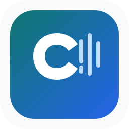

# ColVoice — Voz Colombiana

<p align="center"></p>

Aplicación local en español para generar voz, clonar referencias, convertir grabaciones y diseñar perfiles de voz. Todo el procesamiento se ejecuta en el equipo mediante una interfaz Gradio.

## Inicio rápido

ColVoice funciona en **Windows, Linux y macOS**. La forma más sencilla para una
persona o un agente de código es ejecutar el instalador multiplataforma:

```bash
python setup_colvoice.py
```

El instalador crea el entorno aislado, detecta una GPU NVIDIA cuando está
disponible, instala el backend adecuado y descarga los pesos oficiales. Para
forzar una ruta concreta:

```bash
python setup_colvoice.py --cuda       # NVIDIA CUDA 12.8
python setup_colvoice.py --cpu        # CPU o Apple Silicon/MPS
python setup_colvoice.py --skip-model # preparar dependencias sin descargar pesos
```

Después inicia la aplicación con el launcher incluido en el repositorio y abre
la dirección local que muestre el proceso. Los agentes deben comprobar la API
antes de generar audio:

```bash
python colvoice_cli.py health
```

Consulta [AGENT-SETUP.md](AGENT-SETUP.md) para instalar y operar ColVoice desde
ChatGPT Codex, Claude Code o Antigravity sin leer todo el código fuente.

ColVoice es una aplicación local optimizada para generar, clonar y transformar voces con español colombiano, mexicano y latinoamericano. El paquete Python interno conserva `omnivoice` para mantener compatibilidad con el motor base.

Voice Changer es opcional: descarga Seed-VC desde su proyecto upstream y colócalo en `vendor/seed-vc/` siguiendo [VOICE-CHANGER.md](VOICE-CHANGER.md). El repositorio no redistribuye código de terceros sin verificar ni archivos multimedia de ejemplo.

Consulta [INSTALACION.md](INSTALACION.md) para la instalación completa con NVIDIA/CUDA o CPU, descarga de modelos, uso de la API, clonación con texto pronunciado opcional y control de generación.

Para conectar Codex, Claude Code u otro agente sin leer el código completo, usa [AGENTS.md](AGENTS.md), [API.md](API.md) y `colvoice_cli.py`. La app inicia una API local en `http://127.0.0.1:8002` junto con la interfaz.

## Instalación asistida por agentes

Puedes pedirle a tu agente que clone el repositorio, lea únicamente
`AGENT-SETUP.md`, ejecute `python setup_colvoice.py --cpu` o `--cuda`, compruebe
`colvoice_cli.py health` y genere un audio de prueba. El agente debe pedir
confirmación antes de descargar pesos grandes y nunca debe publicar `models/`,
`voices/`, `outputs/` ni credenciales.

## Funciones

- Texto a voz con español colombiano como configuración inicial.
- Clonación de voz con referencia corta o grabación larga recortada automáticamente.
- Texto pronunciado opcional con transcripción automática mediante Whisper.
- Evaluador de calidad palabra por palabra para detectar omisiones y pronunciaciones problemáticas.
- Modo diálogo con varias voces, similitud de clonación, limpieza local de audio y generación progresiva por fragmentos.
- Voice Changer para conservar ritmo, pausas y actuación de una grabación.
- Biblioteca local de voces y descarga de audios generados.

## Licencias y atribución

Este proyecto es una adaptación de [OmniVoice](https://github.com/k2-fsa/OmniVoice), de k2-fsa. Consulta [CREDITS.md](CREDITS.md) antes de redistribuirlo o desplegarlo públicamente: el código base usa Apache 2.0 y los pesos preentrenados tienen condiciones CC-BY-NC.

No se incluyen en Git los pesos, audios personales, voces guardadas, entornos virtuales, logs ni salidas generadas.
